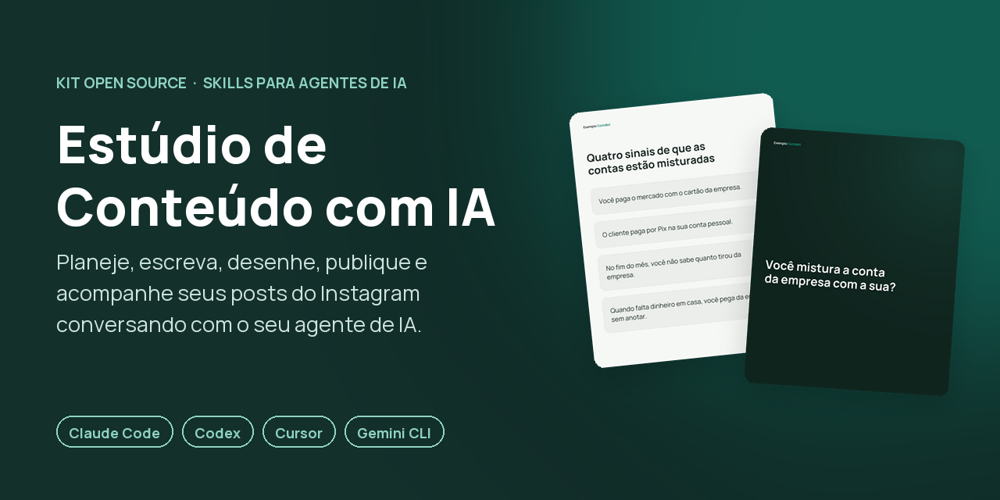
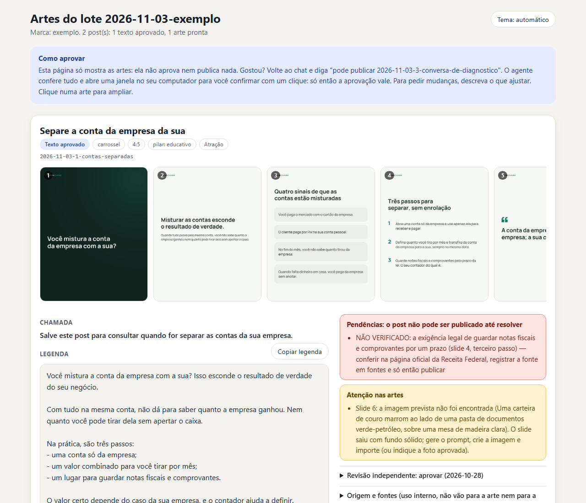
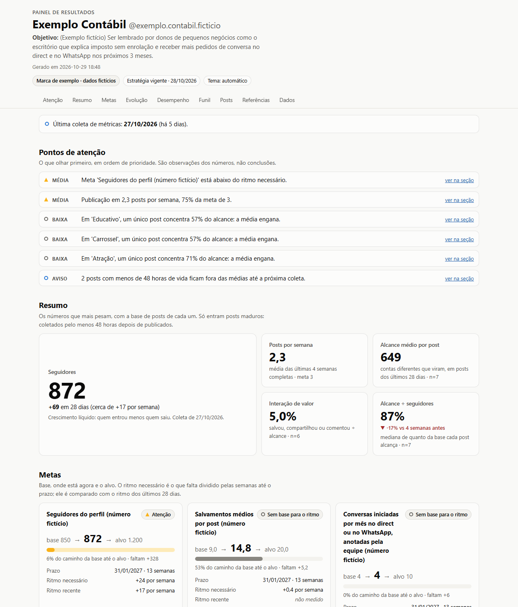
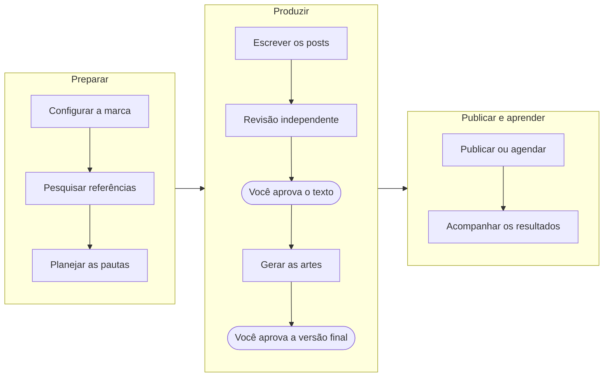

<p align="center">
  
</p>

<p align="center">
  <a href="https://github.com/fermaziero/estudio-de-conteudo-ia/actions/workflows/verificar.yml"></a>
  
  
  
</p>

<p align="center">
  <b>Você conversa. A IA prepara. Você aprova.</b><br>
  Um kit de <i>skills</i> para o seu agente de IA criar, revisar, desenhar, publicar e acompanhar<br>
  o conteúdo do seu Instagram, do começo ao fim, em português.
</p>

<p align="center">
  <a href="#comece-em-5-passos">Comece agora</a> ·
  <a href="#veja-como-fica">Veja como fica</a> ·
  <a href="#como-funciona">Como funciona</a> ·
  <a href="#perguntas-frequentes">Perguntas frequentes</a>
</p>

---

**Skill** é um roteiro de trabalho que o seu agente de IA lê e segue. O agente é o assistente com quem você conversa no computador, como o Claude Code ou o Codex. Você pede em português ("o que eu posto essa semana?"), e ele sabe o caminho: o que perguntar, que arquivo criar, que script rodar e quando parar para pedir o seu ok.

## Por que usar

- **Feito para a sua marca, não para uma marca genérica.** O agente entrevista você uma vez e passa a escrever no seu tom, com as suas regras e os seus limites.
- **Artes sem erro de letra.** O texto é desenhado pelo código, na sua fonte e nas suas cores. A IA nunca escreve dentro de uma imagem nem redesenha um logo.
- **Revisão de verdade.** Antes de você ler, outro agente confere fatos, clareza, português, as suas regras e os dados sensíveis. Se o seu agente não puder abrir outro, ele faz uma passagem separada e avisa.
- **Nada vai ao ar sem você.** A aprovação final pede o seu clique numa janela do seu computador.
- **Aprende com você.** Todo "não gostei" vira regra registrada, e o painel mostra o que funcionou para planejar os próximos posts.

## Veja como fica

Tudo abaixo saiu do kit, usando a **Exemplo Contábil**, uma marca fictícia que vem junto para você testar antes de configurar a sua.

### Um carrossel gerado pelo kit


O texto foi escrito a partir de uma pauta aprovada e passou pela revisão independente. As artes foram desenhadas com as cores e o logo da marca. O slide 6 pede uma ilustração, que você cria na sua ferramenta de imagem e o kit encaixa; como ela ainda não existe no exemplo, o slide ficou fora da montagem.

### A galeria para você aprovar



Cada lote (o conjunto de posts feitos juntos, em geral os da semana) ganha uma página com as artes, a legenda e o que ainda falta resolver. Um post com fato não conferido fica bloqueado até alguém confirmar a fonte.

### O painel de resultados



O painel compara metas, ritmo de publicação e desempenho por tema, formato e etapa do funil (atrair, criar relação ou vender), e diz o que olhar primeiro. Quando falta um dado, aparece "não medido", nunca um zero inventado.

## Como funciona



O que funcionou volta para o planejamento do próximo lote, e cada ajuste que você pede vira regra da marca.

| Você diz ao agente | Skill que entra em ação | O que você recebe |
|---|---|---|
| "Quero configurar minha marca" | `configurar-marca` | A ficha da marca: quem é, tom de voz, regras, visual e metas |
| "Analisa esse perfil de referência" | `pesquisar-referencias` | O que funciona no perfil, comparado com o seu |
| "O que eu posto essa semana?" | `planejar-conteudo` | Pautas (ideias de post) com a frase da capa, o formato e o objetivo, para você aprovar |
| "Escreve o carrossel da pauta 2" | `criar-conteudo` | Slides, legenda e chamada para ação, texto primeiro |
| "Revisa esse post" | `revisar-conteudo` | Um parecer: aprovar, ajustar ou refazer, com o porquê |
| "Gera as artes" | `gerar-artes` | As imagens do post e a galeria de aprovação |
| "Pode publicar" ou "agenda para quinta às 18h" | `publicar-instagram` | O post no ar ou agendado, e o link para conferir |
| "Como estão meus resultados?" | `acompanhar-resultados` | O painel, a leitura do que funcionou e o ajuste das metas |

## Comece em 5 passos

1. **Instale o Python e um agente de IA.** O guia para quem nunca fez isso, no Windows e no macOS, está em [docs/primeiros-passos.md](docs/primeiros-passos.md).
2. **Baixe o projeto.** Nesta página, clique em **Code** e depois em **Download ZIP**, e extraia a pasta. Quem usa git pode fazer `git clone`.
3. **Abra a pasta no seu agente de IA.** Tem de ser a pasta que contém `AGENTS.md`, `skills/` e `marcas/`.
4. **Instale o Pillow**, a biblioteca que desenha as artes. Peça ao agente ("instale o que falta para o estúdio funcionar") ou rode `python -m pip install -r requirements.txt` (no macOS e no Linux, `python3`). Se aparecer "externally-managed-environment", siga o guia de primeiros passos.
5. **Diga: "Quero configurar minha marca."** O agente faz poucas perguntas por vez e monta a sua ficha em `marcas/<sua-marca>/`. Para ver um resultado antes, peça: "Mostre a marca de exemplo".

Depois, é só conversar.

## O que você precisa

| Item | Para quê |
|---|---|
| Computador com Windows, macOS ou Linux | O guia passo a passo cobre Windows e macOS |
| Um agente de IA que leia o `AGENTS.md` (Claude Code, Codex, Cursor, Gemini CLI e outros) | É com ele que você conversa; em geral exige conta, e alguns pedem plano pago |
| Python 3.10 ou mais novo e o Pillow | Rodam os scripts e desenham as artes |
| Conta **profissional** do Instagram, um app na Meta e um *bucket* (espaço de armazenamento na nuvem) para as imagens | Só para publicar e ler os números: [docs/instagram-api.md](docs/instagram-api.md) e [docs/armazenamento-imagens.md](docs/armazenamento-imagens.md) |
| Chrome com o Instagram logado e uma extensão que deixe o agente ler a página | Só para pesquisar perfis de referência |

> **Publicar é a parte que mais dá trabalho para configurar.** Criar o app na Meta e o *bucket* (onde as imagens ficam por alguns minutos na hora de publicar) leva cerca de 1 hora na primeira vez, e o serviço de armazenamento pode pedir um cartão para ativar a conta. **O resto do kit funciona sem isso:** você planeja, escreve, revisa, gera as artes e publica à mão, se preferir.

## Segurança e privacidade

- **Seus arquivos ficam no seu computador.** Tudo da sua marca fica em `marcas/`, que o git do projeto ignora (só a marca fictícia `exemplo` é versionada). Atualizar o projeto não mexe nas suas marcas.
- **Credenciais ficam fora do projeto,** em `~/.config/estudio-de-conteudo/<marca>/`. Você cola o token do Instagram (a "senha de máquina" que deixa o programa publicar sem a sua senha) numa janela que abre no seu computador, nunca no chat. Colou no chat sem querer? Trate como vazado e gere outro.
- **A aprovação final é sua.** Quando você diz "pode publicar" e o código do post, o agente confere tudo e abre uma janela com o resumo do post: a aprovação só é gravada se você clicar em **Aprovar**. Depois do clique, o programa assina a aprovação com uma chave secreta guardada fora do projeto. Editar o arquivo do post à mão não aprova nada, e qualquer mudança no texto ou nas artes cancela o ok.
- **Limite honesto:** quem controla o computador inteiro (um agente que clica na tela por você, por exemplo) ainda poderia contornar essas travas. As regras do projeto proíbem; se o seu agente controla a tela, não deixe que ele clique por você.
- **A IA que você usa lê os seus arquivos,** conforme a política de privacidade do serviço dela. Dados de clientes, alunos ou menores só entram com autorização registrada em `regras.md`, em linha com a LGPD.
- **A pesquisa de referências só lê.** Não curte, não segue, não comenta. A Meta proíbe coleta automatizada sem permissão escrita dela, e o Instagram pode limitar a sua conta: a skill avisa antes de começar e só segue com o seu ok.
- **Achou uma falha de segurança?** Relate pelo caminho descrito em [SECURITY.md](SECURITY.md).

A cada envio ao repositório, uma [verificação automática](.github/workflows/verificar.yml) roda no Windows, no macOS e no Linux, com Python 3.10 e 3.13: procura segredos, valida o exemplo e roda os autotestes. Antes de compartilhar a sua cópia, rode `python -X utf8 ferramentas/checar_segredos.py`.

## Perguntas frequentes

<details>
<summary><b>Preciso saber programar?</b></summary>

Não. Você conversa em português com o agente, e ele roda os comandos. Na primeira vez, você instala o Python e o agente seguindo o [guia de primeiros passos](docs/primeiros-passos.md). Quando o agente pedir permissão para rodar um comando, ele explica antes o que o comando faz.
</details>

<details>
<summary><b>Funciona com qual IA?</b></summary>

Com agentes que trabalham numa pasta do seu computador: Claude Code, Codex, Cursor, Gemini CLI e outros. Claude Code, Codex e Cursor leem o `AGENTS.md` sozinhos; no Gemini CLI, peça "leia o AGENTS.md". Todos acham as skills pelos atalhos que vêm no projeto.
</details>

<details>
<summary><b>Quanto custa?</b></summary>

O kit é gratuito e aberto (licença MIT). Os custos possíveis são de fora: a assinatura do seu agente de IA e, se você publicar pelo kit, o armazenamento de imagens (o [guia](docs/armazenamento-imagens.md) explica).
</details>

<details>
<summary><b>Ele publica sozinho?</b></summary>

Só o que você aprovou. Para agendar, você instala uma rotina no seu computador uma vez (o agente mostra o comando, e quem roda é você). Ela publica no horário com o computador ligado e a sua sessão aberta. Se o computador voltar em até 2 horas depois do horário, o post ainda sai; passado isso, nada é publicado e fica registrado.
</details>

<details>
<summary><b>Publica Reels e Stories?</b></summary>

Ainda não. Nesta versão, o kit publica carrossel e imagem única no feed. Para reel, ele escreve o roteiro, e você grava e posta.
</details>

<details>
<summary><b>Posso ter mais de uma marca?</b></summary>

Sim. Cada marca tem a sua pasta em `marcas/`, com regras, visual, conteúdo e credenciais separados.
</details>

<details>
<summary><b>E se o Instagram mudar alguma coisa?</b></summary>

As APIs (as portas oficiais pelas quais os programas conversam com o Instagram) mudam de tempos em tempos. Os guias registram a data em que cada informação foi conferida na documentação oficial. Se algo parar de funcionar, abra uma *issue* (um aviso de problema) neste repositório.
</details>

## Documentação

| Guia | Para quem | O que tem |
|---|---|---|
| [Primeiros passos](docs/primeiros-passos.md) | Você | Instalar tudo e fazer a primeira conversa |
| [Conectar o Instagram](docs/instagram-api.md) | Você | App na Meta, permissões e token (só para publicar e ler números) |
| [Armazenamento de imagens](docs/armazenamento-imagens.md) | Você | O *bucket* onde as imagens ficam por alguns minutos na hora de publicar |
| [AGENTS.md](AGENTS.md) | O seu agente de IA | O manual que ele segue: fluxo, regras e comandos |
| [Arquitetura](docs/arquitetura.md) | Quem quer contribuir | O contrato entre as skills: pastas, formatos e regras |

<details>
<summary><b>Estrutura das pastas</b></summary>

```
estudio-de-conteudo-ia/
├── AGENTS.md      manual do agente de IA (vale para qualquer agente)
├── CLAUDE.md      complemento para o Claude Code
├── SECURITY.md    como relatar uma falha e como o projeto se protege
├── docs/          guias passo a passo, imagens e o contrato entre as skills
├── skills/        as 8 skills (SKILL.md, scripts, referências e modelos)
├── ferramentas/   sincronizar os atalhos das skills e checar segredos
├── .github/       verificação automática
└── marcas/        os seus dados (fora do git) e a marca de exemplo
```

As pastas `.claude/skills/` e `.agents/skills/` guardam atalhos gerados para o Claude Code e o Codex acharem as skills. Não edite à mão.
</details>

<details>
<summary><b>Atualizar o projeto</b></summary>

Com `git clone`, rode `git pull` na pasta do projeto. Com o ZIP, baixe o novo, extraia em outra pasta e copie para lá a sua pasta `marcas/<sua-marca>`.

Se você instalou a rotina de agendamento, ela guarda o caminho da pasta antiga e continua rodando de lá. Na pasta antiga, rode `python -X utf8 skills/publicar-instagram/scripts/rotina.py remover --marca <sua-marca>` e, na nova, `python -X utf8 skills/publicar-instagram/scripts/rotina.py instalar --marca <sua-marca>` (no macOS e no Linux, `python3`). Quem roda esses dois comandos é você, não o agente.
</details>

## Créditos

Criado por Fernando Maziero para os mentorados da Mentoria 1Advisor.

## Licença

O código é [MIT](LICENSE): você pode usar, adaptar e compartilhar, mantendo o aviso de autoria. **Exceção:** as fontes em `skills/gerar-artes/fontes/` (Manrope) têm licença própria, a SIL Open Font License 1.1 ([detalhes](skills/gerar-artes/fontes/LEIA-ME.md)). Os nomes de produtos citados (Instagram, Meta, Claude, Codex, Cursor, Gemini e outros) pertencem aos seus donos; este projeto é independente e não tem vínculo com eles.
